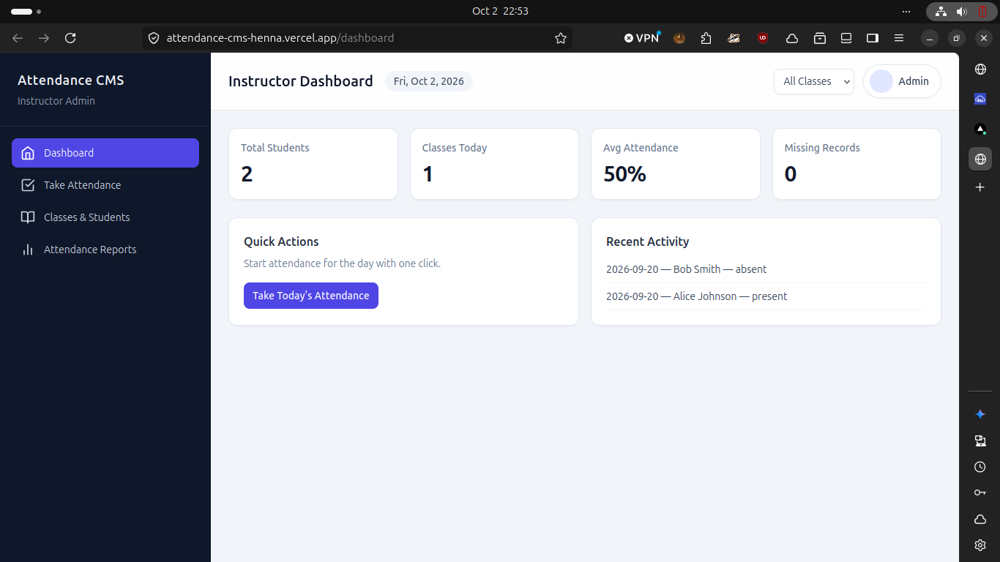

# Student Attendance Management
This is a Vite + React + Tailwind frontend page for a **prospective** Student Attendance Management System.

- [**LIVE HERE!**](https://student-attendance-management.vercel.app/)


Quick start:

```bash
git clone https://github.com/eddy-swe/Attendance-CMS.git
cd Attendance-CMS
npm install
npm run dev
```

Other scripts:

```bash
npm run build   # production build
npm test        # unit tests for the attendance logic
```

## Screenshots
Dashboard: 

Notes:
- Services in `src/services` return Promises and use localStorage for persistence.
- Data seeds are in `src/data`.
- Replace service implementations with `fetch`/`axios` to integrate a Node.js backend later.
